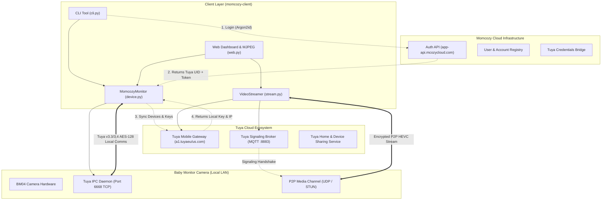
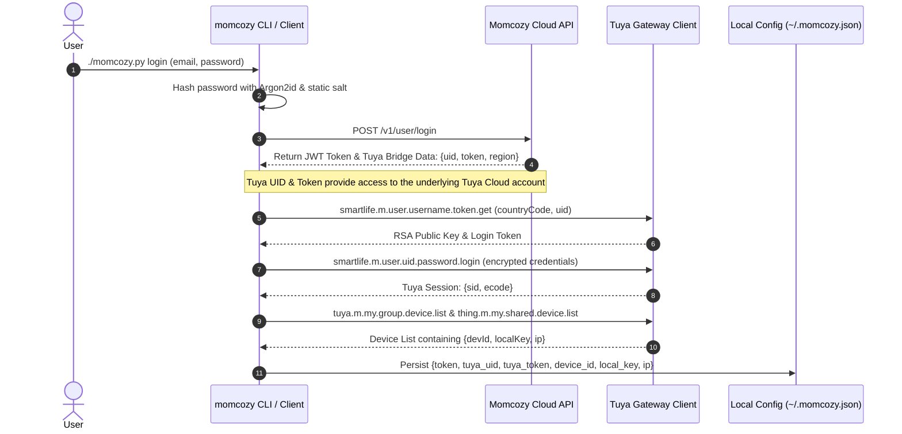
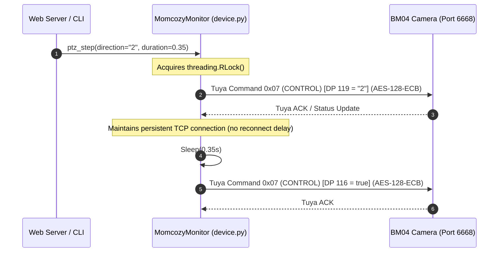
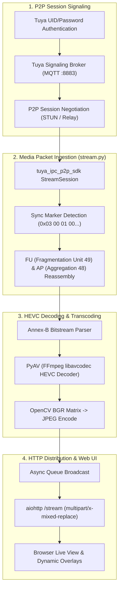
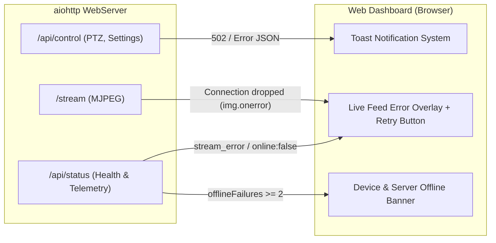

# Momcozy BM04 System Architecture & Technical Deep Dive

This document explains the architecture, communication protocols, and interaction flow of the Momcozy BM04 client library. It details how the **Momcozy Cloud**, **Tuya Cloud Platform**, **Local LAN Communications**, and **P2P Video Streaming Engine** integrate to provide complete local and remote control.

---

## 1. High-Level Architecture Overview

The Momcozy BM04 baby monitor is built on top of the **Tuya IoT / ThingSmart IPC platform**, white-labeled with Momcozy's custom mobile API gateway, brand skins, and firmware identifiers.



---

## 2. Authentication & Credential Bridging Flow

Because the camera hardware runs Tuya firmware, it requires **Tuya credentials** to extract the device encryption keys and stream video. However, end users only possess **Momcozy credentials** (email & password). 

The client bridges this gap through a multi-step authentication exchange:



### Key Technical Aspects:
1. **Argon2id Password Hashing ([`cloud.py`](momcozy/cloud.py)):**
   - The Momcozy mobile app does not transmit plain passwords.
   - It hashes passwords client-side using `Argon2id` with:
     - `time_cost = 2`
     - `memory_cost = 4096 KiB`
     - `parallelism = 1`
     - `hash_len = 32 bytes`
     - Static salt: `base64.b64decode("5waV6ARzSxRgap4h")`
2. **Tuya Cloud Session Management ([`tuya_cloud.py`](momcozy/tuya_cloud.py)):**
   - Momcozy provisions an underlying Tuya user account for each user.
   - The `tuya_uid` and `tuya_token` returned by Momcozy's login endpoint are used with Tuya's `smartlife.m.user.uid.password.login` API to establish a Tuya mobile gateway session.
   - The session tokens (`sid` and `ecode`) allow querying the user's home devices and shared device lists to extract the **16-byte AES `local_key`**.

> [!IMPORTANT]
> **Single Session Constraint:** Tuya mobile gateway permits only one active mobile session per account at a time. The client shares and caches credentials in `~/.momcozy.json` to prevent the video streamer from invalidating the cloud sync session.

---

## 3. Local LAN Device Control (Port 6668)

Once the camera's IP and `local_key` are known, all telemetry controls and PTZ adjustments execute **directly over the local network**, completely bypassing the cloud.



### Communication Protocol Specifications:
- **Port & Transport:** TCP port `6668` on the camera's local LAN IP.
- **Protocol Version:** Tuya protocol `3.3` / `3.4`.
- **Encryption:** AES-128-ECB using the device's 16-character `local_key`.
- **Socket Optimization:**
  - `tinytuya` default behavior initiates a fresh TCP connect and disconnect handshake for every packet if `nowait=True`.
  - [`MomcozyMonitor`](momcozy/device.py) enables `set_socketPersistent(True)` and re-uses open sockets, reducing PTZ dispatch latency from ~300ms down to **30–40ms**.
  - Internal thread safety uses `threading.RLock()` to prevent re-entrant deadlocks when compound commands (e.g. `ptz_step`) call underlying primitives.

### Local vs. Cloud DP Behavior on BM04:
- **Write Control (`set_dp`):** Port 6668 readily accepts Tuya `CONTROL` commands (packet type `0x07`) for PTZ moves, lullaby tracks, volume, night vision modes, and privacy toggles.
- **Read Telemetry (`get_status`):** Unlike standard smart plugs, BM04 firmware ignores local Tuya `DP_QUERY` packets (`0x0A`) on port 6668. To provide seamless status telemetry, [`MomcozyMonitor`](momcozy/device.py) falls back to the device's DPS cached from the Tuya Cloud / local cache.

---

## 4. Live Video Streaming Architecture (P2P & HEVC Reassembly)

The BM04 streams 1080p video using Tuya's proprietary P2P streaming protocol. Unlike common cameras that offer RTSP, the BM04 uses an encrypted UDP transport negotiated via Tuya's signaling brokers.



### Deep Dive into the Video Pipeline:
1. **P2P Signaling Negotiation ([`stream.py`](momcozy/stream.py)):**
   - The client connects to the Tuya MQTT signaling broker on port `8883` using credentials derived from the Tuya account session.
   - P2P session candidates (local UDP, direct WAN, or Tuya relay servers) are negotiated.
2. **HEVC Payload Reassembly ([`MomcozyHevcHandler`](momcozy/stream.py)):**
   - The BM04 sends 1080p video encoded in **HEVC / H.265**.
   - Raw records start with an internal sync marker (`\x03\x00\x01\x00\x00\x00\x00\x00`).
   - Packets contain RTP headers and HEVC NAL units:
     - **NAL Type 49 (Fragmentation Units):** Large I-frames/IDR frames split across multiple network packets. [`MomcozyHevcHandler`](momcozy/stream.py) tracks start/end bits (`S`/`E`) and reconstructs the original NAL unit with standard `0x00000001` start codes.
     - **NAL Type 48 (Aggregation Packets):** Small parameter sets (VPS, SPS, PPS) bundled together. The handler splits them into individual Annex-B NAL units.
3. **Decoding and Transcoding:**
   - [`av.CodecContext.create("hevc", "r")`](momcozy/stream.py) decodes the Annex-B stream into raw BGR video frames.
   - Frames are compressed to JPEG using OpenCV with quality set to `80`.
4. **Smooth MJPEG Serving ([`web.py`](momcozy/web.py)):**
   - Handled via `aiohttp` `/stream` returning `multipart/x-mixed-replace`.
   - **Pacing & Backpressure:** Paced at ~15 FPS (`min_interval = 0.065s`) with explicit `await response.drain()`, preventing 1080p frames (up to 4 MB/s) from overflowing socket buffers or choking the Python event loop.

### Transport Architecture: Local LAN vs. Cloud Relay

A common question is whether the video stream can come via the cloud or if it can be streamed locally over the LAN:

> [!IMPORTANT]
> **Can the video stream come via the cloud?**
> **Yes.** In fact, with the Momcozy BM04, the video stream **always** comes via Tuya's Cloud TCP Relay infrastructure (`tcpRelay` servers over port 1443).

Here is the breakdown of why and how each transport channel works:

| Channel | Protocol / Port | Transport | Path | Why? |
|:---|:---|:---:|:---:|:---|
| **Device Control & Telemetry** (PTZ, Night Vision, Lullaby, Privacy) | Tuya v3.3/3.4 TCP `6668` | **Local LAN** | Client $\rightarrow$ Camera IP | Extremely fast (~30ms), zero cloud latency, operates completely offline on the home network. |
| **Video Live Stream** (1080p HEVC H.265) | Tuya P2P Relay TCP `1443` | **Cloud Relay** | Camera $\rightarrow$ Tuya Cloud Relay $\rightarrow$ Client | Camera firmware has no local RTSP/HTTP server. Direct local ICE peer-to-peer binding triggers role conflicts with camera firmware. |

#### Why Video Uses Tuya Cloud TCP Relay:
1. **No Local Media Daemon:** The BM04 camera only listens on local port `6668` for standard Tuya binary Datapoint commands. It does not run an RTSP, RTMP, or local HTTP video server on LAN.
2. **Firmware ICE Role Incompatibility:** In Tuya's P2P WebRTC/ICE implementation, taking the controlling role locally causes the camera firmware to drop sessions almost immediately (`close_reason=6`). The open-source `tuya_ipc_p2p_sdk` relies on Tuya's managed `RelaySession` (`tcpRelay` cloud endpoints), where Tuya's cloud relay handles media packet routing reliably.
3. **Transport Transparency:** The CLI (`./momcozy.py status`) and Web Dashboard provide real-time indicators:
   - **Control:** `Local LAN (<ip>:6668)` (or `Tuya Cloud Gateway` if IP is not set)
   - **Stream:** `Cloud Relay (Tuya P2P)` badge (with `☁️ Cloud Relay` overlay on the player)

---

## 5. Web Dashboard & Resilient Error Handling

The embedded web server ([`web.py`](momcozy/web.py)) is engineered to eliminate silent failures. When physical devices disconnect, network sessions expire, or commands fail, errors are surfaced immediately.



### Error Reporting Safeguards:
1. **Control Actions (PTZ, Lullaby, Settings):**
   - Web UI `apiPost()` inspects HTTP responses and JSON payloads.
   - If an operation fails (e.g. Tuya socket timeout or camera unreachable), a toast popup displays `❌ Action failed: <error message>` at the top-right corner.
2. **Video Streaming Health:**
   - [`VideoStreamer`](momcozy/stream.py) actively tracks `is_connected` and `last_error`.
   - If credentials expire or Tuya signaling returns an error (e.g. `[code:135] Not authorized`), the `/api/status` endpoint reports `stream_error`.
   - The web UI switches the badge to `STREAM ERROR` and overlays a message and retry button directly on the video player.
3. **Server Unreachability:**
   - If the local Python process terminates or network connectivity is severed, consecutive status poll failures trigger an alert banner warning that the server is unreachable.

---

## 6. Device DataPoint (DP) Reference

The camera's internal functions map to Tuya DataPoint (DP) IDs:

| DP ID | Identifier | Type | Values / Units | Description |
|:---:|:---|:---:|:---|:---|
| **142** | `sensor_temperature` | Integer | `0.1°C` (e.g. `225` = 22.5°C) | Real-time room temperature sensor |
| **236** | `temp_alert_switch` | Boolean | `true` / `false` | Out-of-bounds temperature alarm |
| **240** | `temp_max_cvalue` | Integer | `0.1°C` | High temperature threshold |
| **241** | `temp_min_cvalue` | Integer | `0.1°C` | Low temperature threshold |
| **101** | `basic_indicator` | Boolean | `true` / `false` | Camera front LED status light |
| **103** | `basic_flip` | Boolean | `true` / `false` | 180° Video flip for upside-down mounting |
| **105** | `basic_private` | Boolean | `true` / `false` | Privacy / Sleep mode (disables lens/sensor) |
| **108** | `basic_nightvision` | Enum | `"0"`: Auto, `"1"`: Off, `"2"`: On | IR Cut filter & Night Vision control |
| **116** | `ptz_stop` | Boolean | `true` | Stop current PTZ movement |
| **119** | `ptz_control` | Enum | `"0"`: Up, `"2"`: Right, `"4"`: Down, `"6"`: Left | Move pan/tilt motor |
| **134** | `motion_switch` | Boolean | `true` / `false` | Motion detection toggle |
| **106** | `motion_sensitivity` | Enum | `"0"`: Low, `"1"`: Medium, `"2"`: High | Motion sensitivity |
| **167** | `cry_detection_switch` | Boolean | `true` / `false` | Baby cry detection alarm |
| **138** | `decibel_switch` | Boolean | `true` / `false` | Sound / Noise detection |
| **233** | `ipc_lullaby_control` | Enum | `"0"`: Stop, `"1"`: Play | Lullaby music playback |
| **234** | `ipc_lullaby_list` | Enum | `"0"` to `"7"` | Track selection (White noise, Brahms, etc.) |
| **235** | `ipc_lullaby_volume` | Integer | `0` to `100` | Lullaby playback volume |
| **160** | `basic_device_volume` | Integer | `1` to `100` | Camera speaker master volume |

---

## 7. Configuration Storage (`~/.momcozy.json`)

All credentials and resolved hardware parameters are saved to `~/.momcozy.json` to allow operation without re-authenticating:

```json
{
  "email": "user@example.com",
  "token": "momcozy_jwt_auth_token",
  "device_id": "your_device_id_here",
  "local_key": "your_local_key_here",
  "ip": "192.168.1.100",
  "camera_name": "Baby Room",
  "tuya_uid": "your_tuya_uid_here",
  "tuya_token": "your_tuya_token_here",
  "tuya_region": "EU"
}
```
- `token`: Momcozy Cloud API JWT.
- `local_key`: AES-128 key used for local Tuya LAN communications.
- `tuya_uid` / `tuya_token` / `tuya_region`: Used to authenticate the P2P video stream session via Tuya's signaling brokers.
